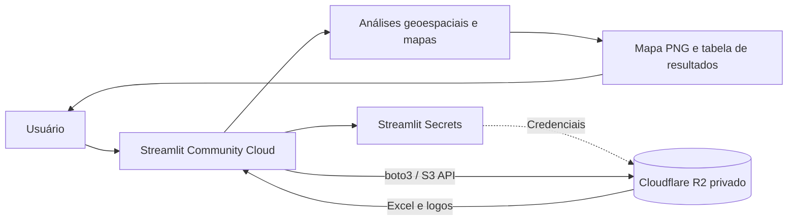

<div align="center">

# 🗼 Tower Intelligence | Mapa de Proximidade

### Inteligência geoespacial para análise de infraestrutura de telecomunicações

**Explore sites existentes, identifique concorrentes próximos e visualize oportunidades em mapas interativos de análise.**


<!-- Substitua o endereço abaixo pela URL pública do aplicativo, se desejar divulgá-lo. -->
<!-- [🚀 Acessar aplicação](https://SEU-APP.streamlit.app) -->

</div>

---

## 📌 Sobre o projeto

O **Tower Intelligence** é uma aplicação em Python e Streamlit para consultar e analisar a proximidade entre sites de telecomunicações e estruturas de operadoras concorrentes. A ferramenta transforma coordenadas geográficas e planilhas de referência em mapas e resultados que apoiam a avaliação de cobertura e oportunidades de infraestrutura.

A aplicação oferece dois modos de análise: pesquisa de um site cadastrado por **ID ou nome** e avaliação de uma **coordenada de oportunidade** informada manualmente.

> **Privacidade:** as planilhas e os logos são lidos de um bucket privado no Cloudflare R2. O aplicativo usa credenciais armazenadas no Streamlit Secrets, sem incluí-las no código-fonte. Isso não substitui autenticação e controles de acesso para os usuários do próprio aplicativo.

## ✨ Funcionalidades

- 🔎 **Busca de sites:** localização por ID ou nome do site.
- 📍 **Análise por coordenadas:** avaliação de oportunidades com latitude e longitude informadas pelo usuário.
- 📏 **Raio configurável:** pesquisas de **500 m a 3 km**.
- 🏢 **Análise competitiva:** exibição de sites ATC e competidores encontrados no raio selecionado.
- 🛰️ **Mapas de contexto:** tentativa de imagens de satélite Esri, com alternativa OpenStreetMap e fallback visual caso os provedores estejam indisponíveis.
- 🧮 **Proximidade geográfica:** busca eficiente com `BallTree` e distância haversine.
- 🧩 **Marcadores personalizados:** logos das operadoras quando disponíveis.
- 📊 **Resultados detalhados:** tabela ordenada por distância, indicadores e quantidade de pontos exibidos.
- 🖼️ **Exportação:** download da imagem do mapa em PNG e opção de copiar a imagem no navegador, quando suportado.
- ⚡ **Cache:** reaproveitamento dos dados e de recursos para reduzir chamadas e processamento repetido.

## 🏗️ Arquitetura



Os dados são processados no servidor do aplicativo, que acessa o R2 por meio da API compatível com S3. O código é separado das credenciais e dos arquivos de dados.

## 🧰 Tecnologias

| Tecnologia | Finalidade |
| --- | --- |
| **Python** | Processamento e lógica da aplicação |
| **Streamlit** | Interface web |
| **Cloudflare R2 + boto3** | Armazenamento privado e leitura dos arquivos |
| **Pandas + OpenPyXL** | Leitura, validação e tratamento das planilhas Excel |
| **NumPy + scikit-learn** | Cálculos e consultas de proximidade com BallTree |
| **Matplotlib + Contextily** | Renderização dos mapas |
| **PyProj** | Transformações de coordenadas |
| **Pillow** | Tratamento dos logos |

## 🚀 Executando localmente

**Pré-requisitos:** Python 3.10 ou superior, acesso a um bucket Cloudflare R2 e credenciais com permissão de leitura dos objetos necessários.

1. Clone o repositório e abra a pasta do projeto:

   ```bash
   git clone https://github.com/SEU-USUARIO/SEU-REPOSITORIO.git
   cd SEU-REPOSITORIO
   ```

2. Crie e ative um ambiente virtual:

   ```bash
   python -m venv .venv
   # Windows PowerShell:
   .venv\Scripts\Activate.ps1
   # Linux/macOS:
   # source .venv/bin/activate
   ```

3. Instale as dependências:

   ```bash
   pip install -r requirements.txt
   ```

4. Crie o arquivo **`.streamlit/secrets.toml`** com suas credenciais:

   ```toml
   [r2]
   endpoint_url = "https://SEU_ACCOUNT_ID.r2.cloudflarestorage.com"
   access_key_id = "SUA_ACCESS_KEY_ID"
   secret_access_key = "SUA_SECRET_ACCESS_KEY"
   ```

5. Inicie o aplicativo:

   ```bash
   streamlit run app_r2.py
   ```

   > Se o arquivo principal no seu repositório tiver outro nome, ajuste o comando.

## 🗂️ Organização esperada no Cloudflare R2

O código atual usa o bucket **`atc-database`** e as seguintes chaves de objeto:

```text
atc-database/
├── data/
│   ├── sites_atc.xlsx
│   └── competidores_anatel.xlsx
└── logos/
    ├── ATC.png
    ├── CLARO.png
    ├── TIM.png
    ├── VIVO.png
    └── ALGAR.png
```

**Estrutura esperada das planilhas:**

| Arquivo | Colunas obrigatórias |
| --- | --- |
| `data/sites_atc.xlsx` | `Site Name`, `ID`, `Lat`, `Lon` |
| `data/competidores_anatel.xlsx` | `ID`, `Lat`, `Lon`, `Entidade` |

A aplicação descarta linhas com coordenadas fora dos intervalos válidos e normaliza os identificadores para a busca.

## ☁️ Publicação no Streamlit Community Cloud

1. Publique o código no GitHub, **sem credenciais nem bases confidenciais**.
2. No Streamlit Community Cloud, configure o repositório, a branch e o arquivo principal (`app_r2.py`, se esse for o nome no GitHub).
3. Em **Settings → Secrets**, adicione os mesmos campos de `.streamlit/secrets.toml`.
4. Confirme que `requirements.txt` contém as bibliotecas necessárias, incluindo `boto3`.
5. Faça o deploy e teste a leitura das duas planilhas e o carregamento dos logos.

## 🔐 Segurança e boas práticas

- Mantenha o bucket R2 **privado** e use credenciais com permissão **Object Read** restrita ao bucket necessário.
- Nunca publique `secrets.toml`, tokens, URLs assinadas ou planilhas confidenciais no GitHub.
- Inclua `.streamlit/secrets.toml`, `.env` e outros arquivos de credenciais no `.gitignore`.
- Se alguma credencial já tiver sido publicada, **revogue ou substitua a credencial** e avalie a limpeza do histórico do Git.
- Lembre-se de que um bucket privado protege os arquivos de acesso direto, **mas não impede consultas aos dados disponibilizados pela interface**. Considere autenticação e autorização no aplicativo se os dados forem confidenciais.
- Revise o conteúdo de logs e mensagens de erro para evitar divulgação de informações internas.

## 🧭 Como usar

1. Escolha entre **Site existente** e **Coordenada de oportunidade**.
2. Informe o ID/nome do site ou as coordenadas desejadas.
3. Ajuste o raio de busca e o limite de pontos exibidos.
4. Clique em **Gerar mapa**.
5. Analise o mapa, os indicadores e a tabela de resultados. Se desejar, baixe a imagem em PNG.

## 📈 Possíveis evoluções

- Autenticação e níveis de acesso por perfil.
- Atualização automatizada das planilhas no R2.
- Filtros adicionais por operadora, região e tipo de infraestrutura.
- Indicadores consolidados e exportação de relatórios analíticos.
- Monitoramento de disponibilidade e falhas de carregamento.

---

<div align="center">

**Desenvolvido com Python, Streamlit e Cloudflare R2 para transformar dados geográficos em insights acionáveis.**

</div>
